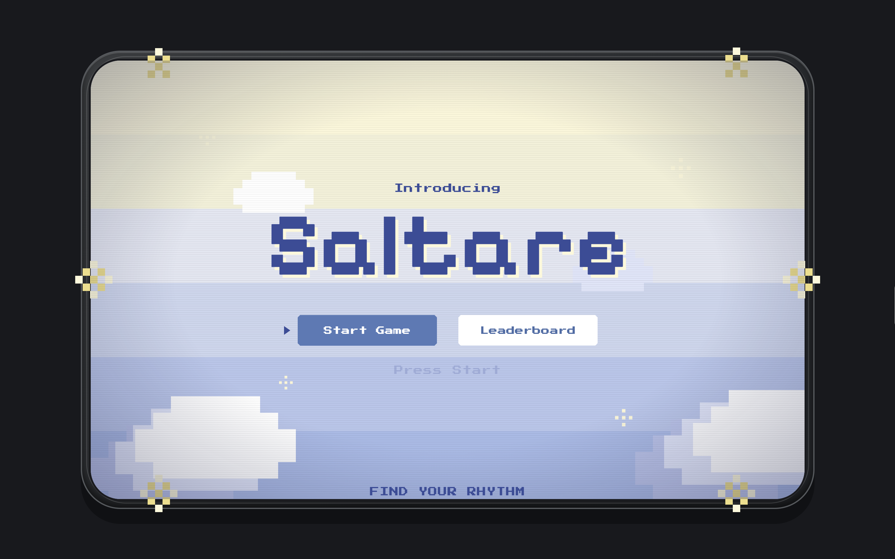

# Saltare

A camera-based dance game. A dance video plays on screen, and the player copies the movements in front of their webcam. The game has three rounds per play, and a set of simple dance movements designed for children.

## How It Works

1. A reference dance video is processed once to extract a skeleton (a set of joint positions) for every frame.
2. During the game, the reference skeleton is drawn on screen so the player knows which pose to copy.
3. The player's webcam feed is processed with the same pose model.
4. The player's joints are compared with the reference joints frame by frame, and the similarity becomes the round score.
5. After round 3, the player enters a name and the total score is saved to the leaderboard.

## Tech Stack

| Layer | Technology |
| --- | --- |
| Frontend | React, Vite |
| Pose model | MediaPipe Pose Landmarker |
| Data | Own video dataset of simple children's dance movements |
| Backend | Python, FastAPI, Uvicorn |
| Video and image processing | OpenCV, NumPy |
| Leaderboard | Firebase Firestore |

## Pose Extraction

Pose extraction uses the MediaPipe Pose Landmarker in video mode. Instead of using all 33 landmarks, the game keeps 15 joints that are enough to describe a dance movement.

```python
JOINTS = {
    "nose": 0,
    "left_shoulder": 11, "right_shoulder": 12,
    "left_elbow": 13,    "right_elbow": 14,
    "left_wrist": 15,    "right_wrist": 16,
    "left_hip": 23,      "right_hip": 24,
    "left_knee": 25,     "right_knee": 26,
    "left_ankle": 27,    "right_ankle": 28,
    "left_foot": 31,     "right_foot": 32,
}
```

- Stores one array of shape `(15, 3)` per frame, containing `x`, `y`, and `visibility` for each joint.
- Marks a joint as `NaN` when it is not detected, has visibility below `MIN_VISIBILITY` (0.5), or falls outside the frame.

The final output is an array of shape `(frames, 15, 3)` plus a matching list of timestamps in milliseconds.


## Getting Started

###  Backend

```powershell
pip install -r requirements.txt
python -m uvicorn backend.main:app --reload --port 8000
```

The API runs at `http://127.0.0.1:8000`.

### Frontend

Create a `.env` file in the frontend folder with your Firebase config:

```
VITE_FIREBASE_API_KEY=
VITE_FIREBASE_AUTH_DOMAIN=
VITE_FIREBASE_PROJECT_ID=
VITE_FIREBASE_STORAGE_BUCKET=
VITE_FIREBASE_MESSAGING_SENDER_ID=
VITE_FIREBASE_APP_ID=
```

Then run:

```bash
npm install
npm run dev
```

The app runs at `http://localhost:5173`. 